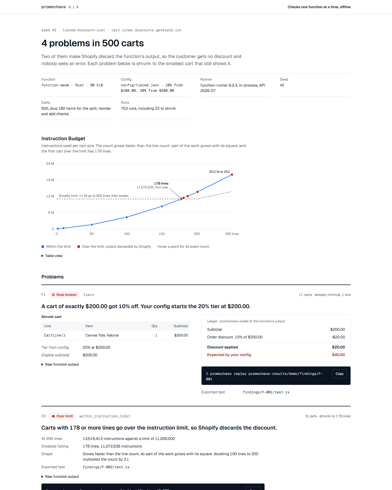

> **Status: pre-release.** Version 0.1.0 is not published yet; until it is, build from source. The results below were measured on 2026-11-15 on one Windows 11 machine (Intel Core i7-1280P, 16 GB), from a source build; anything still marked TBD has not been measured.

# promochaos

promochaos throws hundreds of generated carts at your discount code to find the carts that break it, then shrinks each one to the smallest cart that still breaks it.

It runs discount Functions offline, through function-runner, the same runner the Shopify CLI uses, and it also tests homegrown cart engines through a small command protocol.

## A Walkthrough

A Shopify app developer has a tiered discount Function: 10 percent off from $100, 20 percent from $200, never on gift cards. They build it as usual and run:

```text
$ promochaos run extensions/tiered-discount --config config/tiered.json
```

promochaos generates 500 carts (the default), runs each one through the function and checks every rule. For the example function in this repository, it is built to report four problems:

- A 200-line cart goes over the 11 million instruction limit: it used 13,516,413 instructions, and every cart of 178 lines or more goes over. Shopify discards the output of a run that goes over, so big carts silently get no discount.
- A cart at exactly a tier threshold gets the tier below it: exactly $100.00 gets no discount, and exactly $200.00 gets 10 percent instead of 20.
- The same two shirts on two lines, instead of one line of two, lose the multi-buy discount.
- With no configuration on the discount, the function panics.

Each problem comes with a shrunk cart, the function's raw output, and a ledger showing how the discount was worked out. Each also has a replay command and an exported test the developer can drop into their own test suite. They fix the `>` that should be `>=` and the loop whose cost grows with the square of the line count, re-run, and add `promochaos run` to CI.

## One Function at a Time

promochaos tests one discount function at a time. It does not simulate how Shopify combines several discounts: Functions run independently of each other, and Shopify decides how discounts combine from each discount's combination settings. Every report says this in a section called "What This Run Did Not Check", along with taxes, shipping rates and live store data.

promochaos never talks to a live store, places an order, touches payments or calls a language model. Generation is deterministic: the same seed gives the same carts on every platform.

## What It Checks

| Group | Rules |
|---|---|
| Shopify limits | `no_trap`, `within_instruction_limit`, `within_output_limit`, `within_memory_limit`, `logs_fit` (limits scale above 200 cart lines, as they do at Shopify) |
| Output | `valid_output` (against your `schema.graphql`, and every target id exists in the input), `deterministic` |
| Your rules | `max_discount_percent`, `never_discount`, `tiers`, `min_subtotal`, `codes_accepted` |
| Twin carts | `split_line`, `reorder_lines`, `add_ineligible_line`, `more_spend_never_less` |
| Homegrown engines | `totals_reconcile`, `idempotent_retry`, `usage_limit` |

Each rule is a named check with a fixed sentence template, so every finding reads the same way: "A cart of exactly $100.00 got no discount. Your config starts the 10% tier at $100.00." No model writes text. The full list, and when each rule is not applicable, is in [docs/rules.md](docs/rules.md).

## How Carts Are Generated

1. **Boundaries from your config:** for every threshold, carts one minor unit below, exactly at, and one minor unit above.
2. **Size sweep:** 1, 2, 10, 50, 100, 199, 200, 201 and 250 lines, which finds instruction-budget failures.
3. **Edge shapes:** gift cards, custom products, existing discount allocations, selling plans, bundle children, the same variant on two lines, no buyer, B2B buyers, zero-decimal and three-decimal currencies, missing or odd config, and none, one, unknown or several discount codes.
4. **Pairwise coverage** across line count, gift cards, buyer type, currency, codes and config shape.
5. **Seeded random** carts for the rest.

Money is held in integer minor units, never floats.

## Install

Once released, promochaos is available as:

```sh
npx promochaos run                               # npm
brew install logitsolutionsai/tap/promochaos     # Homebrew
```

Release binaries for Linux, macOS and Windows, with shell and PowerShell installers, are attached to each release at github.com/logitsolutionsai/promochaos/releases. promochaos is not published as a crate.

## Quick Start

```sh
promochaos init                  # writes promochaos.toml and a starter catalog.toml
shopify app function build       # promochaos runs the CLI's built output
promochaos run                   # generate, run, check, shrink, report
promochaos replay promochaos-results/findings/F-001
promochaos budget                # only the size sweep: instructions per cart size
```

`promochaos check-settings` validates `promochaos.toml`, the catalog and the config without running anything.

## Terminal Output

A captured run against the Rust example (release build, 2026-11-15, the machine named at the top; `cargo build --release -p promochaos`, then `bash scripts/build-examples.sh`), with colour turned off:

```text
$ promochaos --color never run --settings examples/functions/tiered-discount-rust/promochaos.toml --out promochaos-results/demo
promochaos 0.1.0 · function-runner 9.2.3 · Functions API 2026-07 · seed 42

function  dist/function.wasm (Rust, 90 KiB) · cart.lines.discounts.generate.run
generate  500 carts + 180 twins · boundaries 18 · sizes 9 · edges 20 · pairwise 14 · random 439
run       730 runs in-process · median 128,760 instructions                 0.32 s
shrink    4 failures, 23 runs                                               0.10 s

✗ F1  tiers                      11 carts   already minimal, 1 line
      A cart of exactly $200.00 got 10% off. Your config starts the 20% tier at $200.00.
      promochaos replay promochaos-results/demo/findings/F-001
✗ F2  within_instruction_limit   8 carts    shrunk to 178 lines
      Carts with 178 or more lines go over the instruction limit, so Shopify discards the discount.
      promochaos replay promochaos-results/demo/findings/F-002
✗ F3  no_trap                    60 carts   already minimal, 1 line
      With no configuration on the discount, the function panicked, so Shopify discards its output.
      promochaos replay promochaos-results/demo/findings/F-003
✗ F4  split_line                 11 pairs   already minimal, 1 line
      Splitting the Linen Shirt line (quantity 2) into two lines removed the discount.
      promochaos replay promochaos-results/demo/findings/F-004

4 problems in 500 carts. Two make Shopify discard the discount.
tests     promochaos-results/demo/findings/F-*/test.rs
report    promochaos-results/demo/report.html   junit promochaos-results/demo/junit.xml   exit 1
```

Symbols carry the meaning (✗ failed, ▲ warning, ✓ passed), and colour only adds to them. `NO_COLOR` and `--color never` are honoured, and there are no spinners when output is not a terminal. `--json` writes machine output to stdout and keeps logs on stderr.

## Instruction Budget

The report opens with a chart of instructions used per cart size, with the limit line, so you can see at a glance whether big carts are safe. `promochaos budget` prints the same numbers. Measured for the Rust example (2026-11-15):

| Lines | Seeded build | Fixed build | Limit |
|---:|---:|---:|---:|
| 1 | 67,748 | 68,869 | 11,000,000 |
| 10 | 265,346 | 247,648 | 11,000,000 |
| 50 | 1,574,254 | 1,030,400 | 11,000,000 |
| 100 | 4,319,968 | 1,989,238 | 11,000,000 |
| 178 | 11,072,635 (first over) | not run | 11,000,000 |
| 200 | 13,516,413 | 3,905,737 | 11,000,000 |
| 201 | 13,633,443 | 3,926,739 | 11,055,000 |
| 250 | 19,967,019 | 4,868,157 | 13,750,000 |

The chart is at the top of the report, shown in the next section.

## The Report

`report.html` is one offline file: fonts embedded, no network requests, no tracking. The first line is the verdict. Then the instruction budget chart, then each problem with its sentence, the shrunk cart, a ledger labelled "promochaos model of this function's output" ("promochaos reading of the engine's priced cart" for a homegrown engine), the raw output, the replay command and the exported test path. A rules table shows how many carts each rule checked, failed and could not check, and why. The report follows the reader's light or dark setting.

<picture>
  <source media="(prefers-color-scheme: dark)" srcset="docs/images/report-tiered-dark.png">
  
</picture>

The top of the report for the Rust example's seeded build, from the run under Terminal Output.

## Outputs

```text
promochaos-results/
  run.toml           resolved settings, tool, function-runner and API versions, seed
  results.json       every cart run and finding; schema in docs/results-schema.json
  junit.xml          for CI test reporting
  report.html
  findings/F-001/
    cart.json        the shrunk cart in promochaos's model
    input.json       the shrunk function input
    output.json      the raw function output
    ledger.json      the application model's working
    finding.toml
    fixture.json     a fixture for the Shopify Functions JS test helpers (loadFixture)
    test.rs          a Rust #[test] using shopify_function::run_function_with_input (Rust functions only)
```

## Settings

`promochaos.toml`, in the app root or passed with `--settings`:

```toml
[target]
kind = "shopify-function"
extension = "extensions/tiered-discount"     # reads shopify.extension.toml
config = "config/tiered.json"                # the discount metafield's jsonValue
discount_classes = ["ORDER", "PRODUCT"]

[store]
currency = "USD"
catalog = "catalog.toml"                     # products, variants, prices, tags, collections, gift cards
codes = ["WELCOME20"]

[rules]
max_discount_percent = "30"
never_discount = { tags = ["gift-card"], gift_cards = true }
tiers = { at = "/tiers", threshold = "threshold", percent = "percentage" }
min_subtotal = "50.00"
metamorphic = ["split_line", "reorder_lines", "add_ineligible_line", "more_spend_never_less"]

[generate]
seed = 42
carts = 500
max_lines = 250
currencies = ["USD", "JPY", "KWD"]
```

Targets, discovery and the command protocol are described in [docs/targets.md](docs/targets.md).

## Homegrown Cart Engines

promochaos also tests promotion engines on homegrown or headless checkouts. Your engine reads a cart as JSON on stdin and prints a priced cart as JSON on stdout:

```toml
[target]
kind = "command"
run = ["./target/debug/homegrown_cart"]
reset = ["./target/debug/homegrown_cart", "--reset"]
timeout_ms = 2000
tax_inclusive = false
shipping_discount_in = "discounts"
```

promochaos runs the program directly, without a shell, with a timeout and a 1 MB cap on its output. On top of the merchant rules, it checks that totals reconcile, that a retried order with the same idempotency key does not use a coupon twice, and that a coupon is never used more times than its limit.

## Exit Codes

| Code | Meaning |
|---|---|
| 0 | No failures |
| 1 | Failures found |
| 2 | Invalid input or config |
| 3 | Target unavailable (no Wasm file, no binary) |
| 4 | Internal error |

## Examples

The `examples` folder holds three targets, each with seeded bugs and a fixed build that must pass every rule:

- `examples/functions/tiered-discount-rust`: a Rust discount Function with four seeded bugs (a `>` at tier thresholds, work that grows with the square of the line count, an `unwrap()` on the config, and a multi-buy counted per line instead of per variant).
- `examples/functions/bundle-discount-js`: a JavaScript discount Function with three seeded bugs (discounts gift cards, emits a percentage over 100 for large bundles, accepts any entered code).
- `examples/homegrown-cart`: a homegrown engine behind the command protocol with three seeded bugs (stacked discounts bypass the 30 percent cap, the free-shipping threshold uses the pre-discount subtotal, a retried order uses the coupon twice).

The seeded JavaScript build gives six findings for its three bugs, and all six are expected. Three are the seeded bugs (`valid_output`, `never_discount`, `codes_accepted`). Two follow from them: the uncapped bundle percentage also breaks the 60 percent cap (`max_discount_percent`), and discounting gift cards means adding a gift card changes the discount (`add_ineligible_line`). The sixth is real too: carts of 198 lines or more go over the instruction limit (11,051,224 instructions at 198 lines, measured 2026-11-15). The fixed build stays under the limit at every size. The example's own README lists the six.

The homegrown example needs neither a Shopify login nor the Shopify CLI. The two example Functions do, as the next section explains.

## Running the Shopify Examples

CI tests promochaos's logic, the unit tests and the homegrown example, on Linux, macOS and Windows. It does not build or run the two example Functions, because they need the Discount Function API schema, `schema.graphql`, and only the Shopify CLI can fetch it, after a Shopify login that CI does not have. This repository does not include the schema, because we found no licence that allows us to redistribute it, and `.gitignore` keeps local copies out of commits. In CI their tests print SKIPPED and pass. Run them locally before each release:

1. **Install the Shopify CLI** (`npm install -g @shopify/cli`), and the trampoline tool `shopify-function-trampoline` 2.0.1 from the Shopify/shopify-function-wasm-api releases if you build the Rust example without the CLI.
2. **Log in and fetch the schema.** The fetch needs the client ID of an app in your own Shopify developer account (`examples/shopify.app.toml` holds a placeholder). The CLI asks you to log in to Shopify in your browser the first time.

   ```sh
   cd examples
   shopify app function schema --path functions/tiered-discount-rust --client-id <your app client ID>
   shopify app function schema --path functions/bundle-discount-js --client-id <your app client ID>
   cd ..
   ```

3. **Build** the homegrown engine and both Functions, seeded and fixed. The build needs no login.

   ```sh
   bash scripts/build-examples.sh    # or: pwsh scripts/build-examples.ps1 on Windows
   ```

4. **Run** every example test, with skips turned into failures:

   ```sh
   PROMOCHAOS_REQUIRE_EXAMPLES=1 cargo test --release -p promochaos --test examples
   ```

   Or run one example by hand, as under Terminal Output:

   ```sh
   cargo run --release -p promochaos -- run --settings examples/functions/tiered-discount-rust/promochaos.toml --out promochaos-results/demo
   ```

The build scripts stop with the fetch command when a schema is missing. The runner-parity test also needs `function-runner` 9.2.3 on the PATH.

## Measured Results

| Measure | Result |
|---|---|
| Seeded bugs found (10 seeded) | 10 of 10: Rust example 4 of 4 (4 findings), homegrown engine 3 of 3 (3 findings), JavaScript example 3 of 3 (6 findings: the 3 seeded bugs, 2 that follow from them and 1 real instruction-limit failure from 198 lines; see Examples) |
| False alarms on the fixed builds | 0 on all three fixed builds, 500 carts each (300 for the homegrown engine) |
| Carts per second, Rust example | 500 carts with 180 twin carts and all shrinking in 0.65 s to 2.1 s end to end over two timed runs; the 730 function runs alone took 0.32 s to 0.41 s. Release build. The spread comes from other builds sharing the CPU |
| Carts per second, JavaScript example | Fixed build: 500 carts in 5.1 s to 12.8 s end to end over two runs. Seeded build: 19.1 s to 49.9 s, most of it shrinking six findings. Release build; built with the Shopify CLI, no login needed. The spread comes from other builds sharing the CPU |
| Instruction curve of the Rust example, before and after the fix | 13,516,413 instructions at 200 lines before (first over the limit at 178 lines), 3,905,737 after; the table under Instruction Budget has every size |
| Machine used for the measurements | Windows 11 Pro, Intel Core i7-1280P (20 threads), 16 GB, Rust 1.95.0, 2026-11-15 |

## Building From Source

```sh
rustup show                       # installs the pinned toolchain (Rust 1.95.0 and wasm32-unknown-unknown)
cargo build --release -p promochaos
# fetch the example schemas first (see Examples), then:
bash scripts/build-examples.sh    # or: pwsh scripts/build-examples.ps1 on Windows
cargo test --workspace
```

See [CONTRIBUTING.md](CONTRIBUTING.md) for the checks a pull request must pass.

## Licence

Apache-2.0. See [LICENSE](LICENSE) and [NOTICE](NOTICE). promochaos links the open-source function-runner from Shopify (Apache-2.0) as a library, and embeds the Geist fonts (SIL Open Font License 1.1) in its reports. The licences of every Rust crate in the release binary are listed in [THIRD-PARTY-LICENSES.html](THIRD-PARTY-LICENSES.html), which is generated by cargo-about and included in every release archive.

## Built by Logit Solutions AI

promochaos is built and maintained by Logit Solutions AI. It is one of a set of small open-source developer tools we publish.

- [AI in eCommerce guide](https://logitsolutions.ai/guides/ai-in-ecommerce/): where tools like this fit in an online store's engineering.
- [Production-Ready AI guide](https://logitsolutions.ai/guides/production-ready-ai/): testing and shipping software that has to hold up in production.
- [Book a free consultation](https://logitsolutions.ai/contact/) to talk through your checkout or promotion engine.
